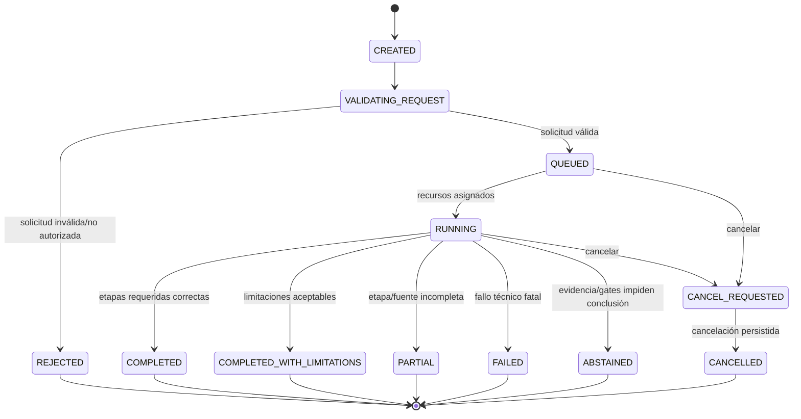

# Máquina de estados de ejecución

**Estado:** Propuesta metodológica; pendiente de implementación. **Versión:** 0.1.0

## 1. Separación de estados

Mantener estados independientes para:
- **Request:** intención y autorización explícita del usuario.
- **Execution:** ciclo técnico de extremo a extremo.
- **Stage:** estado individual de cada etapa.
- **Source capture:** resultado de cada adaptador/fuente.
- **Decision:** conclusión informativa de inversión.

Una ejecución COMPLETED puede producir una decisión INSUFFICIENT_EVIDENCE. Un resultado ABSTAINED no significa que el proceso técnico haya fallado.

## 2. Estados de solicitud y ejecución

| Estado | Significado | Terminal |
|---|---|---|
| CREATED | Solicitud registrada con request_id | No |
| VALIDATING_REQUEST | Validación de campos, alcance y autorización | No |
| REJECTED | Solicitud inválida o no autorizada | Sí |
| QUEUED | Solicitud válida esperando recursos | No |
| RUNNING | Una o más etapas están ejecutándose | No |
| PARTIAL | Ejecución interrumpida o incompleta con resultados parciales preservables | Sí, salvo reanudación explícita |
| COMPLETED | Todas las etapas requeridas concluyeron correctamente | Sí |
| COMPLETED_WITH_LIMITATIONS | Resultado válido con limitaciones declaradas | Sí |
| FAILED | Fallo técnico no recuperable dentro de la ejecución | Sí |
| CANCEL_REQUESTED | Usuario solicitó cancelar; se está propagando la señal | No |
| CANCELLED | Cancelación confirmada y estado persistido | Sí |
| ABSTAINED | No existe base suficiente para una conclusión según gates/políticas | Sí |

Los estados terminales no se reabren ni se reescriben. Una reanudación o nueva ejecución se registra como nuevo intento/ejecución enlazado al expediente previo.

## 3. Diagrama de transición

## 4. Reglas de transición

- Solo una solicitud validada puede pasar a QUEUED.
- Solo QUEUED puede iniciar RUNNING.
- CANCEL_REQUESTED no se convierte en CANCELLED hasta confirmar que tareas y escrituras se detuvieron o quedaron aisladas de forma segura.
- Un fallo no se marca COMPLETED por el mero hecho de generar un resumen.
- PARTIAL exige indicar etapas completadas, fallidas, omitidas y pendientes.
- COMPLETED_WITH_LIMITATIONS exige justificar por qué los datos restantes no invalidan el alcance reducido.
- ABSTAINED debe contener motivo, gates implicados, afirmaciones bloqueadas y evidencia necesaria para reanudar.
- Las transiciones terminales son inmutables.

## 5. Estados de etapa

Cada etapa utiliza un conjunto coherente: PENDING, READY, RUNNING, COMPLETED, COMPLETED_WITH_LIMITATIONS, SKIPPED_NOT_APPLICABLE, BLOCKED, FAILED o CANCELLED. Toda transición guarda timestamp, actor/proceso y razón.

## 6. Invariantes

- Una ejecución no puede estar simultáneamente en dos estados terminales.
- No se publica informe COMPLETED si falta una etapa obligatoria.
- No se permite decisión favorable si existe un gate bloqueante.
- Una etapa no consume output de otra ejecución.
- Una etapa SKIPPED requiere motivo y regla que la permite.
- Un estado desconocido no se traduce a COMPLETED ni a riesgo bajo.
